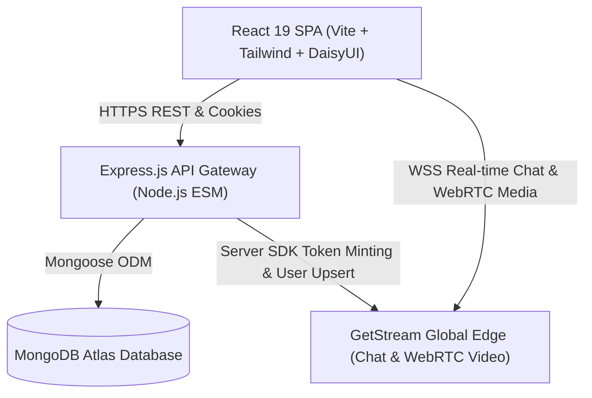

# 🌐 Streamify — Real-Time Language Exchange & Video Calling Platform

> **Live Deployment:** [https://stream-z290.onrender.com](https://stream-z290.onrender.com)  
> **Repository:** [https://github.com/ansh1325/stream](https://github.com/ansh1325/stream)  
> **Video Walkthrough Demo:** [](https://lnkd.in/p/gpASuBD8) *(Replace `YOUR_YOUTUBE_VIDEO_LINK_HERE` with your video URL)*

---

## 🌟 Overview

**Streamify** is a production-grade full-stack language exchange platform that connects global learners for 1-on-1 real-time messaging and peer-to-peer WebRTC video calls. Built with high availability, modern UI aesthetics, and enterprise-grade security standards in mind, Streamify seamlessly handles real-time bidirectional communication, authenticated user state management, and localized partner discovery.

---

## 🏗️ Architecture & System Design

Streamify utilizes a consolidated full-stack architecture combining a Vite-powered React client with an Express/Node.js API gateway, backed by MongoDB Atlas and GetStream's real-time streaming infrastructure.



### Key Architectural Highlights

1. **Hybrid Real-Time Pipeline**:
   - Authentication, user relations, and discovery are orchestrated via an Express REST API and MongoDB.
   - High-throughput messaging and audio/video signaling are offloaded directly to GetStream's distributed edge infrastructure, reducing backend CPU overhead and eliminating WebSocket server bottlenecks.

2. **Security & State Resilience**:
   - **Zero-Storage Tokens**: JWT session tokens are issued via HTTP-only, `sameSite` cookies with cryptographic validation to mitigate XSS and CSRF attack surfaces.
   - **Stream Token Minting**: Stream chat and video tokens are signed securely on the backend using HMAC credentials only after JWT verification.

3. **Unified Production Bundle**:
   - In production, the Node.js server dynamically serves the pre-compiled Vite frontend bundle with SPA fallback routing, minimizing hosting complexity and avoiding cross-origin cookie restrictions.

---

## 🚀 Core Features

- 🔐 **Secure Authentication & Onboarding**: Email/password signup with bcrypt hashing, personalized onboarding for native and target languages, and automatic avatar generation via DiceBear.
- 🤝 **Intelligent Language Partner Discovery**: Filtered queries recommend non-friend learners based on learning profile compatibility while automatically excluding current connections.
- 📬 **Bidirectional Friend System**: Atomic friend request handling with real-time request counts, acceptance workflows, and reactive badge updates.
- 💬 **Next-Gen Chat Interface**: Integrated with GetStream Chat SDK v14 featuring rich text composition, live read receipts, thread management, typing indicators, and emoji reactions.
- 📹 **HD Video Calling**: Streamlined WebRTC video conferencing with in-call media controls, speaker layout, and instant invitation links shareable straight from the chat window.
- 🎨 **Adaptive Multi-Theme Engine**: Built on DaisyUI and Zustand with 32 curated accessible themes persisted locally across page reloads.

---

## 🛠️ Tech Stack

| Domain | Technology |
|---|---|
| **Frontend Framework** | [React 19](https://react.dev/), [Vite 8](https://vitejs.dev/) |
| **Routing & Navigation** | [React Router v7](https://reactrouter.com/) |
| **Client State & Cache** | [TanStack React Query v5](https://tanstack.com/query), [Zustand](https://zustand-demo.pmnd.rs/) |
| **Styling & Design** | [Tailwind CSS v3](https://tailwindcss.com/), [DaisyUI v4](https://daisyui.com/), [Lucide React](https://lucide.dev/) |
| **Real-Time Video & Chat** | [Stream Chat React SDK v14](https://getstream.io/chat/), [@stream-io/video-react-sdk](https://getstream.io/video/) |
| **Backend Runtime** | [Node.js](https://nodejs.org/) (ES Modules), [Express.js](https://expressjs.com/) |
| **Database & ODM** | [MongoDB Atlas](https://www.mongodb.com/atlas), [Mongoose v8](https://mongoosejs.com/) |
| **Security & Auth** | [JSON Web Tokens (JWT)](https://jwt.io/), [bcryptjs](https://github.com/dcodeIO/bcrypt.js), `cookie-parser` |
| **Deployment** | [Render](https://render.com/) Web Service |

---

## ⚙️ Environment Variables

Create a `.env` file in `backend/` and configure the following variables:

```env
# Server
PORT=5001
NODE_ENV=production

# Database
MONGODB_URI=mongodb+srv://<username>:<password>@cluster.mongodb.net/<dbname>

# Authentication
jwt_key=your_super_secret_jwt_key

# GetStream API Credentials
STREAM_API_KEY=your_stream_api_key
STREAM_API_SECRET=your_stream_api_secret
```

For the frontend build, provide `VITE_STREAM_API_KEY`:

```env
VITE_STREAM_API_KEY=your_stream_api_key
```

*(Note: The codebase includes backwards-compatible fallbacks for `STEAM_API_KEY` and `JWT_SECRET`.)*

---

## 💻 Local Development Setup

### 1. Clone the repository
```bash
git clone https://github.com/ansh1325/stream.git
cd stream
```

### 2. Install dependencies
```bash
npm run build
```
*(This automatically runs `npm install` across both `backend` and `frontend`, then compiles the frontend client.)*

### 3. Run the development servers
In terminal 1 (Backend):
```bash
cd backend
npm run dev
```

In terminal 2 (Frontend):
```bash
cd frontend
npm run dev
```

---

## 📡 API Endpoints

### Authentication (`/api/auth`)
- `POST /api/auth/signup` — Register a new account & upsert Stream user
- `POST /api/auth/login` — Authenticate credentials & issue HTTP-only JWT
- `POST /api/auth/logout` — Invalidate session cookie
- `GET  /api/auth/me` — Retrieve active session user
- `POST /api/auth/onboarding` — Complete learner language profile

### User Relations (`/api/users`)
- `GET  /api/users` — Fetch recommended language exchange partners
- `GET  /api/users/friends` — List current user friends
- `POST /api/users/friend-request/:id` — Dispatch a friend request
- `PUT  /api/users/friend-request/:id/accept` — Accept incoming request
- `GET  /api/users/friend-requests` — Retrieve incoming & accepted requests
- `GET  /api/users/outgoing-friend-requests` — List pending sent requests

### Real-Time Chat & Video (`/api/chat`)
- `GET  /api/chat/token` — Generate cryptographic Stream user token
- `POST /api/chat/token` — Fallback token endpoint

---

## 📄 License

This project is licensed under the [ISC License](LICENSE).
